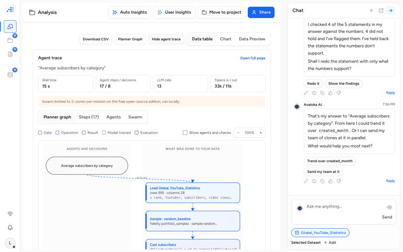
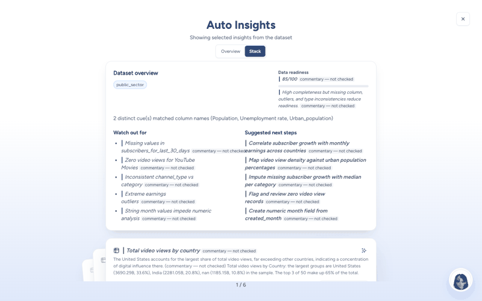
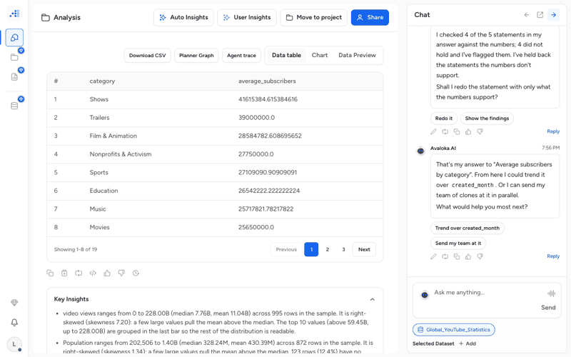
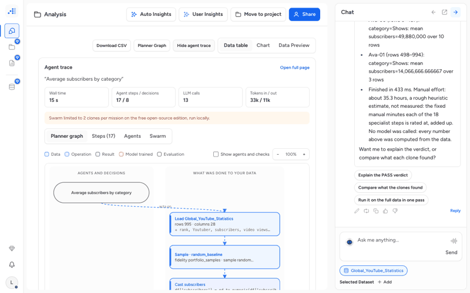
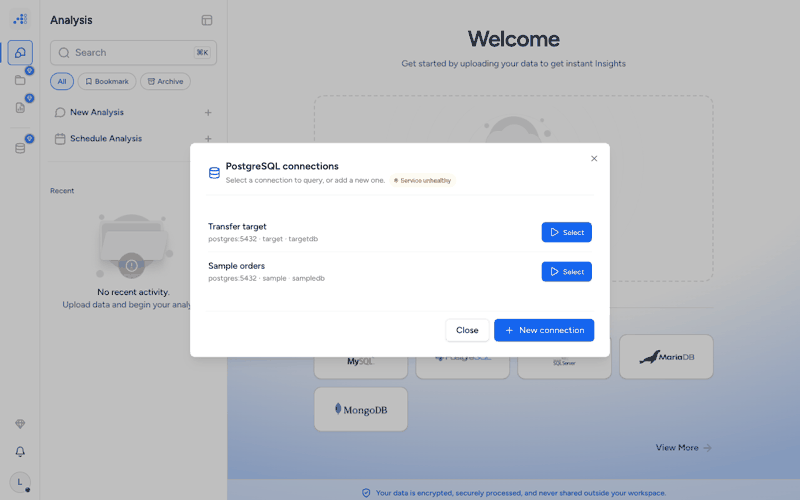
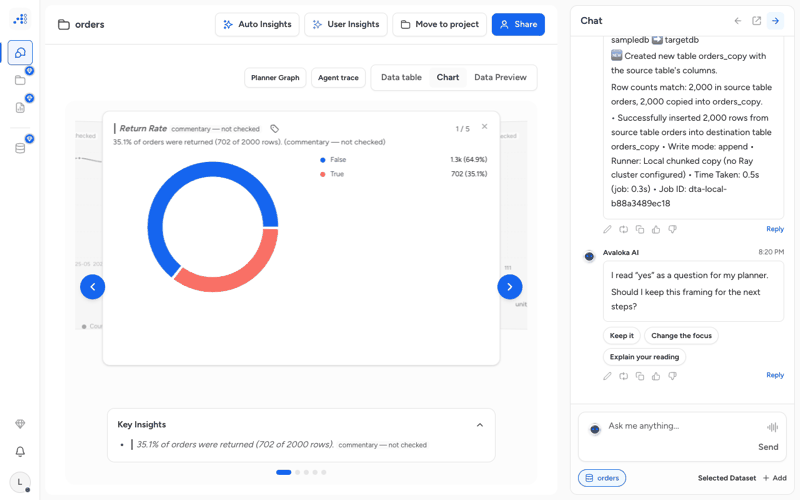

# Avaloka 2.0 — Demo Guide

How to show Avaloka 2.0 (the line that becomes `develop-1.7`) to data
scientists, analysts and data engineers, in the web app and on the command
line. Each step tells you what to do, what appears, what to say, and how to
recover if it goes wrong.

**This guide covers `integration/2.0` at commit `c3b27651` (VERSION 2.0.0).**
It describes only what is merged there. Every command and output below comes
from a real run on that commit, and every web-app step was checked on the local
quickstart stack built from it (see
[How this guide was checked](#how-this-guide-was-checked)). A step that could
not be checked says so.

For the full product reference, see the [User Guide](USER_GUIDE.md), the
[CLI guide](cli-user-guide.html) and the README section
[How to read an answer](../README.md#how-to-read-an-answer).

---

## Contents

- [Pick a demo](#pick-a-demo)
- [Avoid claiming](#avoid-claiming)
- [Setup](#setup)
- [Pre-demo checklist](#pre-demo-checklist)
- [How to read an answer](#how-to-read-an-answer)
- [The 5-minute demo](#the-5-minute-demo)
- [The 15-minute demo](#the-15-minute-demo)
- [The 30-minute deep dive](#the-30-minute-deep-dive)
- [Track: data scientist](#track-data-scientist)
- [Track: analyst](#track-analyst)
- [Track: data engineer and admin](#track-data-engineer-and-admin)
- [Reset between demos](#reset-between-demos)
- [How this guide was checked](#how-this-guide-was-checked)

---

## Pick a demo

| Time | Audience | Path |
| --- | --- | --- |
| 5 min | anyone | [The 5-minute demo](#the-5-minute-demo): one terminal, no server, no account |
| 15 min | analysts, data scientists | [The 15-minute demo](#the-15-minute-demo): the CLI, then the web app |
| 30 min | a technical team | [The 30-minute deep dive](#the-30-minute-deep-dive): all three tracks |

Every dataset used here ships in the repository:

| File | What it is | Used for |
| --- | --- | --- |
| `avaloka/examples/churn.csv` | 1,200 customers, 7 columns (tenure, charges, contract, region, `churned`) | training, leakage, grouped answers, the swarm |
| `app/sample_data/Global_YouTube_Statistics.csv` | 995 YouTube channels, public Kaggle dataset | analysis, charts |
| `app/sample_data/salaries.csv` | 5 rows, 5 columns | the smallest possible upload |
| the quickstart's `sample` Postgres database | a 2,000-row `orders` table seeded by `deploy/compose/quickstart/seed.sql` | connections and transfers |


---

## Avoid claiming

> **Do not say any of these on 2.0. Each one was checked against the code at `c3b27651`.**
>
> - **Don't demo on a shared or hosted 2.x deployment until the security ports
>   land.** Some security fixes made on 1.6 are still being ported to 2.x. Demo
>   on your own laptop with the quickstart and public data, as this guide does.
> - **What-if analysis or outcome reports.** The code for them exists in the
>   repository but nothing in the web app, the API or the CLI calls it. They are
>   not a feature yet.
> - **"It always runs a swarm."** The swarm runs **only when asked**: words such
>   as "swarm this", "send in the team", "clone yourself" or "fan out", or the
>   **Send my team at it** quick reply. An ordinary question never starts one.
> - **"Every answer is checked."** The claim checker runs on ordinary answers.
>   **A swarm's merged answer skips it**: the swarm reply is built and returned
>   before the checker runs. Present swarm results as the clones' computed
>   tables, not as checked prose.
> - **Forecasting.** There is no forecasting model. A "forecast" request only
>   chooses a time-ordered split when training.
> - **A model card, feature importance or a "run truth" view in the web app.**
>   None is shown in the web app. The CLI writes `model_card.md`.
> - **Scheduled reports on the quickstart.** The quickstart starts no scheduler
>   worker, so scheduling is not available there. Scheduling needs the Celery
>   worker and beat of a full deployment.
> - **Big swarms on the open-source edition.** The OSS and Free editions cap a
>   swarm at **2 clones**, and the CLI says so when you ask for more. The live
>   swarm page is for Professional and Enterprise.
> - **The CLI's hours and dollar figures as measured.** The CLI labels them
>   itself: "rough heuristic estimate, not measured".
> - **"Secure" in general.** Name the specific things this guide shows
>   (database passwords entered through the connection form, self-generated
>   secrets) and stop there.

---

## Setup

### The command line (all you need for the 5-minute demo)

Python 3.11 or 3.12.

```bash
git clone <your Avaloka 2.0 checkout> avaloka && cd avaloka
python3.11 -m venv .venv && source .venv/bin/activate
pip install -e .
avaloka --version        # prints 2.0.0
```

No CLI command needs a model key. A model is used only with `--llm` or
`--llm-provider` (`local`, `groq`, `openrouter`, `openai`, `anthropic`); without
either, nothing leaves the laptop.

### The web app (quickstart)

```bash
export INFERENCE_PROVIDER=openrouter OPENROUTER_API_KEY=...   # optional: hosted model
scripts/quickstart.sh up          # builds from this checkout, starts the stack, prints the URL
scripts/quickstart.sh password    # the sign-in password
scripts/quickstart.sh down --volumes   # stop and delete the demo data
```

**You'll see**, at the end of `up`:

```
Avaloka is up in 58s.
  open      http://127.0.0.1:3000/
  sign in   local@avaloka.local
  password  run: scripts/quickstart.sh password
  API       http://127.0.0.1:9001/health
  stop      scripts/quickstart.sh down
```

The API was on 9001 here because 9000 was taken. **Read the ports from your own
`up` output; don't assume them.**

- **Secrets generate themselves.** The first `up` writes `.env.quickstart`
  (mode 600, gitignored) with the sign-in secret, email and password,
  `DB_ENCRYPTION_KEY`, `MCP_SERVICE_TOKEN` and the sample-database password.
- **Sign-in** is local, with email and password. The sign-in page says: "Local
  account. The password is in .env.quickstart (scripts/quickstart.sh
  password)."
- **Models.** The quickstart's default is **local**: Ollama on this machine,
  with `gemma4:e4b` (`ollama pull gemma4:e4b`). This guide's web runs used
  **OpenRouter** with `openai/gpt-oss-120b`, selected by exporting
  `INFERENCE_PROVIDER=openrouter` and `OPENROUTER_API_KEY` before `up`, as
  above. For the smaller local **Qwen3**, run
  `ollama pull qwen3:4b-instruct-2507-q4_K_M` and set
  `INFERENCE_LOCAL_MODEL=qwen3:4b-instruct-2507-q4_K_M`. *Not verified for this
  guide:* the local models (gemma4 and Qwen3) were not run; rehearse with them
  first.
- **What it starts:** the UI, the API, a LangGraph server, the MCP server,
  Redis, a sample Postgres (`sample`, with a 2,000-row `orders` table) and an
  isolated code executor. **No scheduler worker.**

---

## Pre-demo checklist

- [ ] `avaloka --version` prints `2.0.0`.
- [ ] A scratch folder for outputs, and the leaky churn copy from step 5.2.
- [ ] Web app: `scripts/quickstart.sh status` shows every service up, and you
      can sign in.
- [ ] Web app: the model works. Send one test question before the audience
      arrives (the local default is slow on a laptop; OpenRouter is faster).
- [ ] Browser zoom at 100–110%, notifications off.

---

## How to read an answer

Read this section to the audience, or put it on a slide. It is the README's own
wording ([README.md](../README.md#how-to-read-an-answer)):

> Avaloka's explanation can be wrong. The model writes the words; the figures
> come from code that ran on your data, and Avaloka checks the figures in the
> reply against what that code computed.
>
> - **A figure it cannot confirm is held back**, and the reply says so ("I've
>   held back N statements…" with the reason).
> - **Anything the model wrote is marked "commentary — not checked"** (shown
>   muted and labelled in the web app, dimmed in the CLI, and carried as
>   `reply_segments` in the API). Treat it as the model's reading, not as a
>   verified finding. Text written by code from the data — scope lines, the
>   data notes on upload cards, counts and statistics — is shown plain.
> - **Each answer computed from your data comes with the table it was computed
>   from**, in the analysis workspace (the Output view, with Download CSV), so you
>   can check any figure against the rows yourself.

One exception to tell them about: **a swarm's merged answer is not run through
the claim checker** (see [Avoid claiming](#avoid-claiming)).

---

## The 5-minute demo

One terminal. No server, no account, no model key.

### 5.1 Train and validate a model in one command

**Do this:**

```bash
avaloka train avaloka/examples/churn.csv --target churned
```

**You'll see** (about 10 seconds; trimmed):

```
Avaloka  This one's compact — 1,200 rows. I'll analyse the whole thing live,
right now, nothing held back.
...
    ↩ Ava-Scout returns: Profiled 7 columns x 1200 rows; quality score 100/100
with 0 issues flagged; reads as telecom / churn data (confidence 0.95).
...
    ↩ Ava-Scientist returns: Trained 3 candidate(s); selected
'logistic_regression' on CV roc_auc 0.7628 (holdout 0.8061).
  ✦ Ava-conformal_calibrator sets off — she handles a specialised step.
    ↩ Ava-conformal_calibrator returns: Calibrated classification uncertainty at
target coverage 90.0%.
...
What I found
  • Conformal label set at 90% target coverage: mean set size 1.51; empirical
coverage 93.3% on held-out rows.
  • Best model 'logistic_regression' scored 0.8061 roc_auc on holdout.
...
Validation verdict: PASS; max safe deployment level 4/4
...
│ Estimated manual effort            19.6 hours (rough heuristic estimate, not │
│                                                                    measured) │
```

**Say this:** "It picks the model on cross-validation, not on one lucky split,
and it tells you how often its prediction sets cover the truth on rows it never
saw."

**If it goes wrong:** a missing-file error means you are not in the repo root;
use the full path to `churn.csv`.

### 5.2 Show it refusing a model that cheats

**Do this:** make a copy of the data with a column that gives the answer away,
then train on it.

```bash
python3 - <<'PY'
import csv
rows = list(csv.DictReader(open("avaloka/examples/churn.csv")))
with open("churn_leaky.csv", "w", newline="") as f:
    w = csv.DictWriter(f, fieldnames=list(rows[0]) + ["account_closed"])
    w.writeheader()
    for r in rows:
        r["account_closed"] = r["churned"]
        w.writerow(r)
PY
avaloka train churn_leaky.csv --target churned -o leaky-model
```

**You'll see:**

```
  • Potential target leakage detected; resolve before trusting model metrics.
...
Validation verdict: FAIL; max safe deployment level 1/4
  ✗ target_leakage: 1 feature(s) appear to encode the target: account_closed
```

**Say this:** "A perfect score is the warning sign. It names the column that
leaks the answer and caps the model at research-only."

**If it goes wrong:** if the verdict is PASS, check `head -1 churn_leaky.csv`
ends in `account_closed`.

### 5.3 Send in the swarm

**Do this:**

```bash
avaloka coordinate avaloka/examples/churn.csv --goal "average churned by contract" --swarm 4 -o churn-fleet
```

**You'll see** (about 7 seconds):

```
Swarm limited to 2 clones on the free open-source edition: you asked for 4, so 2
will run.
Avaloka  Cloning myself into 2 sub-Avalokas — each takes a shard of the same
data and runs her own swarm.
  ✦ Ava-00 takes shard 0 (600 rows)
  ✦ Ava-01 takes shard 1 (600 rows)
    ↩ Ava-00 back — verdict=pass
    ↩ Ava-01 back — verdict=pass
...
Answer
Answer to “average churned by contract”: mean churned by contract, merged from 2 clones (each mean weighted by its rows) — month-to-month 0.473842, two-year 0.21659, one-year 0.213376; highest month-to-month (computed over every row of the 2 shards).
  · Ava-00 (rows 0–599): contract=month-to-month: mean churned=0.466472 over 343 rows
  · Ava-01 (rows 600–1,199): contract=month-to-month: mean churned=0.481595 over 326 rows

Converged verdict: PASS  (max safe deployment level 1/4)
Execution: 2 concurrent sub-Avalokas · answer: every row of 2 shards (1,200
rows) · profiling: every row
...
Swarm trace: 63 records, one episode per clone → churn-fleet/swarm_trace.json
```

**Say this:** "Each clone answers on its own shard; the merge weights each
shard's mean by its rows, so the combined figure is the full-data figure. Every
step is in the trace file."

**If it goes wrong:** the open-source edition caps the swarm at two clones and
says so on the first line; that is expected, not an error.

---

## The 15-minute demo

1. The [5-minute demo](#the-5-minute-demo) (5 min).
2. [How to read an answer](#how-to-read-an-answer) (1 min).
3. [AN-1 to AN-3](#track-analyst) in the web app (9 min).

## The 30-minute deep dive

1. The [5-minute demo](#the-5-minute-demo) (5 min).
2. [Track: data scientist](#track-data-scientist), DS-4 to DS-7 (7 min).
3. [Track: analyst](#track-analyst), all steps (10 min).
4. [Track: data engineer and admin](#track-data-engineer-and-admin) (8 min).

---

## Track: data scientist

DS-1 to DS-3 are steps 5.1 to 5.3 above.

### DS-4. Read the model card

**Do this:**

```bash
cat avaloka-model/model_card.md
```

**You'll see** (from the 5.1 run):

```
## Validation checks

- **data_sufficiency** — PASS: ~50 rows/feature suggests >= 300 rows for 6 features.
- **target_leakage** — PASS: No feature is near-perfectly predictive of the target.
- **split_validity** — PASS: Used 'stratified_train_test' (960 train / 240 test rows).
- **beats_baseline** — PASS: CV roc_auc 0.763 beats the prior baseline (0.500) by more than fold noise.
- **stability** — PASS: CV roc_auc = 0.763 +/- 0.029 (stable).
- **overfitting** — PASS: Holdout and CV scores are consistent.
```

**Say this:** "Six checks, each with the number behind it."

**If it goes wrong:** no `model_card.md` means the train run failed; rerun 5.1.

### DS-5. Gate a deployment

**Do this:**

```bash
avaloka deploy avaloka-model --level 2
avaloka deploy leaky-model --level 2
```

**You'll see:**

```
Validator cap: Level 4/4  (Production candidate)
Requested: Level 2  →  Achieved: Level 1 (Research artifact)
```

then, for the leaky model,

```
Validator cap: Level 1/4  (Research artifact)
Requested: Level 2  →  Achieved: Level 1 (Research artifact)
```

**Say this:** "The validator would allow the clean model all the way to a
production candidate; it is held at Level 1 only because we did not ask for a
deployment package. The leaky one can never leave research."

**If it goes wrong:** to reach Level 2 and above, train with `--deployable`.

### DS-6. Commentary versus computed figures in the CLI

**Do this:** the same grouped question, with a hosted model writing the
narration (one key; a few cents at most):

```bash
export OPENROUTER_API_KEY=...        # your key
avaloka analyze avaloka/examples/churn.csv --goal "average churned by contract" --llm-provider openrouter -o churn-llm
```

**You'll see:**

```
LLM: openrouter · openai/gpt-oss-120b
...
Avaloka  I’m splitting into eight focused copies, each handling the part she
does best. (commentary — not checked)
...
Avaloka  All nine copies are in, and I’m stitching their findings into a single
answer. (commentary — not checked) ...
...
What I found
  • mean of churned: 0.3592 over 1,200 valid rows (95% CI 0.3325 to 0.3883).
  • contract=month-to-month: mean churned=0.4738.
  • contract=two-year: mean churned=0.2166.
  • contract=one-year: mean churned=0.2134.
```

**Say this:** "Every sentence the model wrote carries 'commentary — not checked'.
The findings are plain because code computed them. On this run the model even
miscounted its own copies, eight then nine. That is exactly why the label is
there."

**If it goes wrong:** `LLM:` missing from the first line means no key was found;
the run still completes without narration.

### DS-7. The agent trace in the web app

**Do this:** after an answer in the analysis workspace, click **Agent trace**.

**You'll see** the question at the top, then **Wall time** (15 s on the demo
run), **Agent steps / decisions** (17 / 8), **LLM calls** (13) and **Tokens in
/ out** (33k / 11k), a note "Swarm limited to 2 clones per mission on the free
open-source edition, run locally.", the tabs **Planner graph**, **Steps (17)**,
**Agents** and **Swarm**, and the planner graph. The graph shows each operation
on the data with its code: Load, Sample, Cast subscribers, Group by category →
mean, Sort, and the result. **Open full page** opens it on its own.



**Say this:** "Every step, and the code it ran, for this one answer."

**If it goes wrong:** the trace belongs to the turn it was opened from. Ask
again, then open it, to see a new turn.

---

## Track: analyst

### AN-1. Sign in and upload

**Do this:** sign in with the quickstart email and password. On the landing
page, **Browse files** → `app/sample_data/Global_YouTube_Statistics.csv` →
**Clean & Start**.

**You'll see** the upload review ("995 rows detected across 28 columns.",
**Key Metrics Identified**, **Dataset Issues**: "Duplicate Data Found", "Empty
cells found"), then **Auto Insights**. Model-written lines there carry the label
**commentary — not checked**.



**Say this:** "Anything the model wrote is labelled. Plain text is computed."

**If it goes wrong:** **Skip** at the review step returns to the landing page
without opening the analysis; use **Clean & Start**.

### AN-2. Ask in plain English, and see a claim held back

**Do this:** type *"Average subscribers by category"*.

**You'll see** the computed table (19 rows, Shows first at 41,615,384.6), with
**Download CSV**, **Planner Graph** and **Agent trace** above it. In the chat on
the demo run, the checker held back most of the model's sentences:

```
I checked 4 of the 5 statements in my answer against the numbers; 4 did not
hold and I've flagged them. I've held back the statements the numbers don't
support.
Shall I redo the statement with only what the numbers support?
```

with the buttons **Redo it** and **Show the findings**.



**Say this:** "The model wrote five sentences; four didn't match the numbers,
so you don't see them. The table is what the code computed."

**If it goes wrong:** whether claims are held back depends on what the model
wrote that time. On another run the reply may be clean; the table is the same.

### AN-3. Send in the swarm

**Do this:** type *"Swarm this: average subscribers by category"*, or click the
**Send my team at it** suggestion.

**You'll see** "My team is back. Here's what they did:", then "Team size: 2
clones, within the 2 that the free open-source edition allows per mission.",
the shards ("2 shards of 498 and 497 rows"), each clone's verdict, and the
merged answer: "Shows 41,615,384.615385, Trailers 39,000,000, Film & Animation
28,584,782.608696; highest Shows (computed over every row of the 2 shards)". It
ends: "No model was called: every number above was computed from the data."



**Say this:** "Two clones, each on its own shard; the merged mean matches the
single-pass table exactly."

**If it goes wrong:** the merged swarm answer is not run through the claim
checker. Present its computed numbers, as here, not its prose.

### AN-4. Scheduling

**Do this:** type *"Every Monday at 9am, recompute average subscribers by
category."*

**You'll see** "Scheduling isn't available in this deployment — no task worker
(Celery) is running, so I can't create or manage scheduled jobs right now. The
analysis itself still works; ask me to run it immediately instead."

**Say this:** "On a full deployment with the scheduler this becomes a cron job;
the quickstart deliberately leaves the scheduler out."

> **Not verified:** the agent trace's **Swarm** tab for a swarm turn was not
> opened on the demo run.

## Track: data engineer and admin

### DE-1. Connect two databases

**Do this:** landing page → **PostgreSQL** tile → **New connection**. Register
the quickstart's sample database (host `postgres`, port 5432, database
`sample`, user `avaloka`, the password from `.env.quickstart`) as
`sampledb`. Register a second, empty database as `targetdb`. For the demo it
was created with `CREATE DATABASE target` in the quickstart Postgres.

**You'll see** both in the **PostgreSQL connections** list: "postgres:5432 ·
sample · sampledb" and "postgres:5432 · target · targetdb".



**Say this:** "The password goes in once, through the form."

**If it goes wrong:** the list's status pill read "Service unhealthy" on the
demo run even though registration and the transfer worked. Don't rely on it.

### DE-2. A database-to-database transfer with row counts

**Do this:** in the connections list, **Select** `sampledb` → **List tables** →
tick `orders` → **Analyze selected tables (1)**. In the chat type *"Transfer to
targetdb, new table orders_copy"*, then reply *yes*.

**You'll see:**

```
sampledb ➡️ targetdb
🆕 Created new table orders_copy with the source table's columns.
Row counts match: 2,000 in source table orders, 2,000 copied into orders_copy.
• Successfully inserted 2,000 rows from source table orders into destination table orders_copy
• Write mode: append • Runner: Local chunked copy (no Ray cluster configured) • Time Taken: 0.5s
```



**Say this:** "It counts both sides and tells you they match."

**If it goes wrong:**
- Put a comma after the connection name ("to targetdb, new table …"). Without
  it, "targetdb new" was read as the connection name.
- The transfer starts only on a plain **yes**. On the demo run the chat also
  showed a "Should I keep this framing?" card; clicking **Keep it** there
  cancelled the transfer, or was read as a table name.

### DE-3. Passwords: use the connection form

Registering a database by typing its password into chat was not recognised on
the demo run (the chat asked to confirm its framing instead). **Use the
connection form, not chat, for passwords.**

## Reset between demos

**Command line:**

```bash
rm -rf avaloka-model leaky-model churn-fleet churn-by-contract churn-llm churn_leaky.csv
```

**Web app:** `scripts/quickstart.sh down --volumes`, then `up` again, gives a
clean stack with new secrets. To keep the stack, start each demo from **New
Analysis** and upload again. Deleting a single analysis was not tried.

## How this guide was checked

- **Command line:** every command above was run on `c3b27651` in a fresh
  Python 3.11 virtualenv (`pip install -e .`). The outputs are quoted from
  those runs, trimmed but not edited. Only DS-6 used a model key (OpenRouter).
- **Web app:** checked in headless Chromium (Playwright) against
  `scripts/quickstart.sh up`, built from `c3b27651` on an Apple-silicon Mac
  (arm64 images), with `INFERENCE_PROVIDER=openrouter` (`openai/gpt-oss-120b`).
  Steps marked **Not verified** say why.
- **Seeded for the demo:** an empty `target` database, for DE-2.
