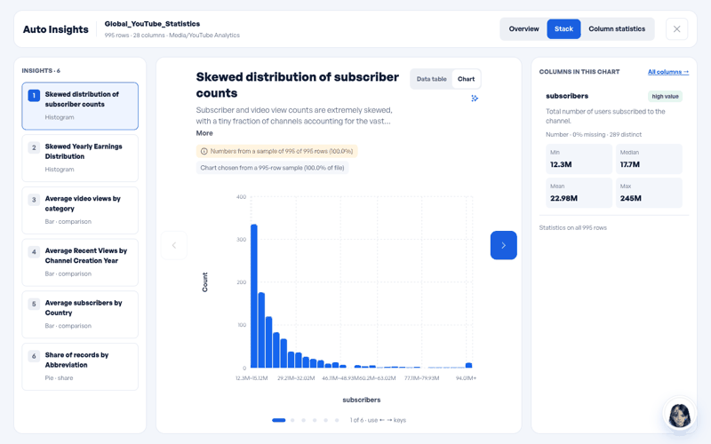
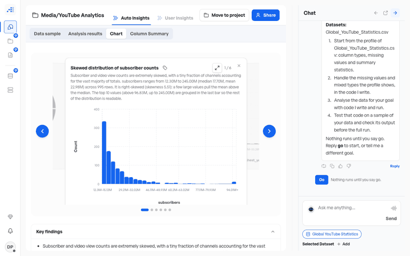
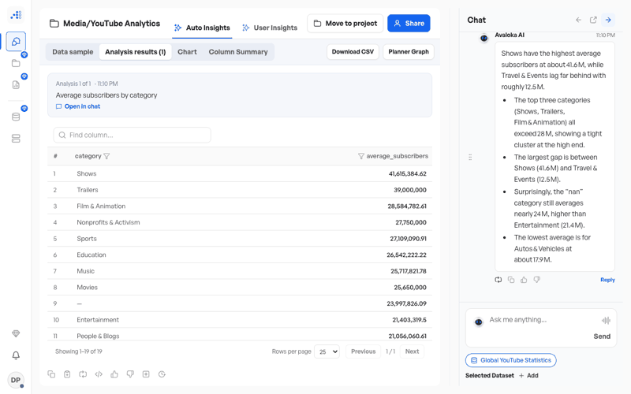
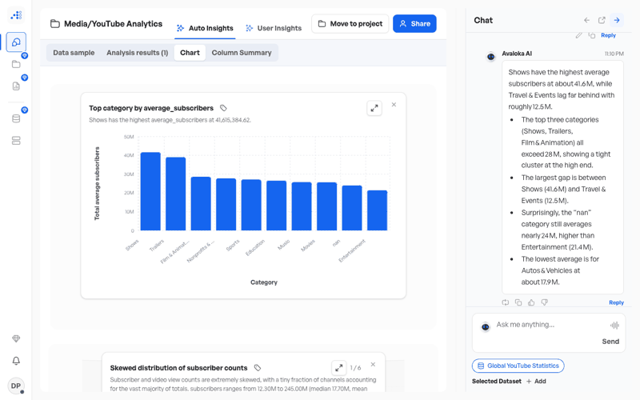
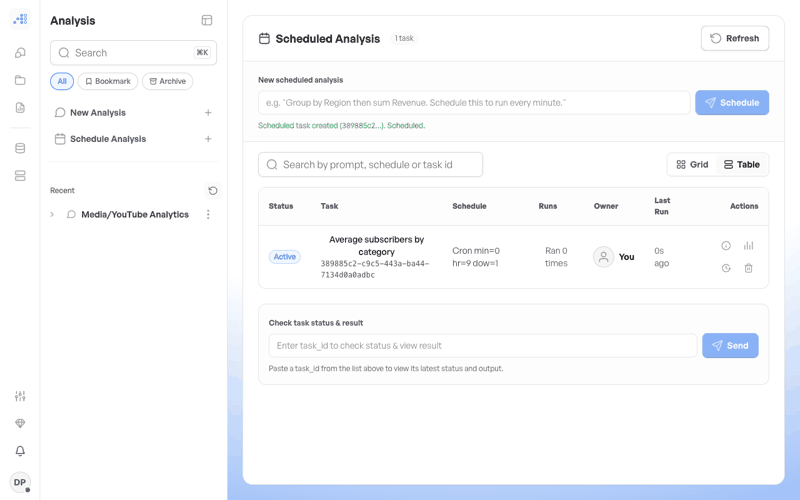
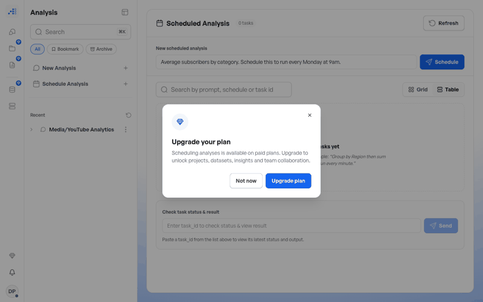
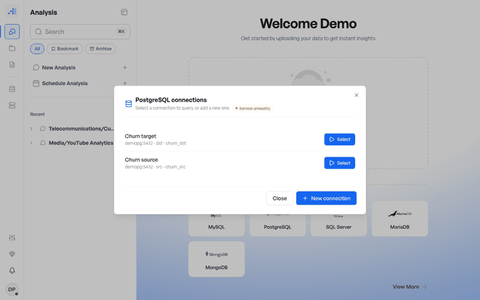
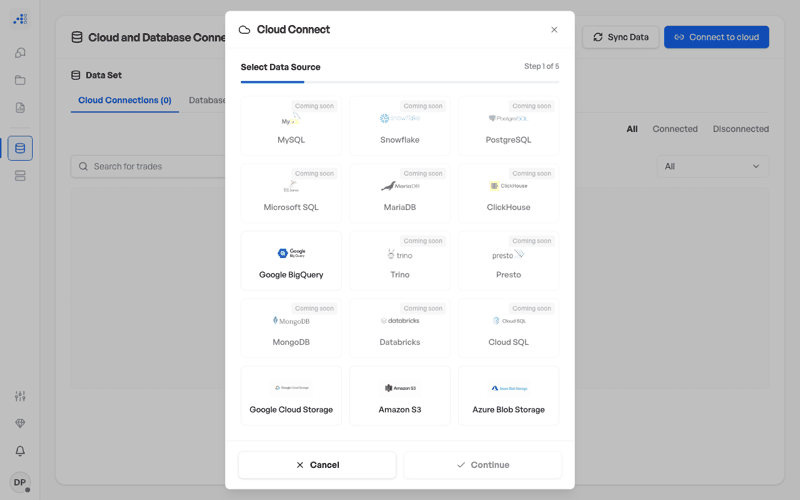

# Avaloka 1.6 — Demo Guide

How to show Avaloka 1.6 to data scientists, analysts and data engineers, in the
web app and on the command line. Each step tells you what to do, what appears,
what to say, and how to recover if it goes wrong.

**This guide covers `develop-1.6` at commit `7fd77f09`.** It describes only
what is merged there. Every command and output below comes from a real run on
that commit. Every web-app step was checked on a local stack built from the
same commit (see [How this guide was checked](#how-this-guide-was-checked)),
except those marked **Not verified**, which say why.

For the full product reference, see the [User Guide](USER_GUIDE.md) and the
[CLI README](../README_CLI.md). This guide is the short, presentable path through
them.

---

## Contents

- [Pick a demo](#pick-a-demo)
- [Avoid claiming](#avoid-claiming)
- [Setup](#setup)
- [Pre-demo checklist](#pre-demo-checklist)
- [The 5-minute demo](#the-5-minute-demo)
- [The 15-minute demo](#the-15-minute-demo)
- [The 30-minute deep dive](#the-30-minute-deep-dive)
- [Track: data scientist](#track-data-scientist)
- [Track: analyst](#track-analyst)
- [Track: data engineer and admin](#track-data-engineer-and-admin)
- [Reset between demos](#reset-between-demos)
- [How this guide was checked](#how-this-guide-was-checked)

---

## Pick a demo

| Time | Audience | Path |
| --- | --- | --- |
| 5 min | anyone | [The 5-minute demo](#the-5-minute-demo): one terminal, no server, no account |
| 15 min | analysts, data scientists | [The 15-minute demo](#the-15-minute-demo): the CLI, then the web app |
| 30 min | a technical team | [The 30-minute deep dive](#the-30-minute-deep-dive): all three tracks |

Every dataset used here ships in the repository and is public:

| File | What it is | Used for |
| --- | --- | --- |
| `avaloka/examples/churn.csv` | 1,200 customers, 7 columns (tenure, charges, contract, region, `churned`) | training, leakage, grouped answers |
| `app/sample_data/Global_YouTube_Statistics.csv` | 995 YouTube channels, public Kaggle dataset | analysis, charts |
| `app/sample_data/salaries.csv` | 5 rows, 5 columns | the smallest possible upload |
| `app/sample_data/yellow_tripdata_2015-01_dataset_50k.csv` | 50,426 NYC taxi trips, public TLC data | a bigger upload |
| `tests/execution_agent/data/iris.csv` | 150 rows, the iris measurements | a quick classifier |


---

## Avoid claiming

> **Do not say any of these on 1.6. Each one was checked against the code at `7fd77f09`.**
>
> - **Forecasting or what-if.** There is no forecasting model and no what-if
>   tool. A "forecast" goal only changes one line of the plan to "Analyse the
>   trend over time with code I write and run."
> - **Warehouse connectors.** In **Connect to cloud**, Snowflake, Databricks,
>   ClickHouse, Trino, Presto, Cloud SQL and the other database tiles show
>   **Coming soon**. Only Google BigQuery and the storage buckets (S3, GCS,
>   Azure Blob) are live there. Database connections (PostgreSQL, MySQL and
>   others) go through the **Data sources** tiles instead.
> - **Full-dataset Ray analysis.** A Ray analysis runs on a **50,000-row sample**
>   (the file's first rows). The reply says so in a note. Read the note out;
>   don't call the figures exact.
> - **"It checks my numbers."** The claim verifier runs on each chat answer, and
>   the web app shows a notice **only when something did not check out**. No
>   notice does not mean "verified". On the demo stack, replies with no notice
>   still contained model mistakes: one called Autos & Vehicles the lowest
>   category while its own table put Travel & Events lower; another said "No
>   category exceeds 30 million" one line after giving Trailers 39.0 million.
>   **Point at the result table, not the prose.** Say "it flags claims that
>   don't match the computed results", nothing stronger.
> - **A model card or feature-importance view in the web app.** Neither exists in
>   the web app. The CLI writes a `model_card.md`. Feature importance is not
>   produced by either.
> - **The wrong plan for collaboration.** As merged (#660, #661): **Free**
>   shares by email or public link only. **Professional** invites
>   collaborators onto its own analyses and reports (the invitee may be on any
>   plan, Free included) and forms teams whose members are Professional or
>   higher. **Enterprise** has everything. **Departments, roles, branches and
>   app users are Enterprise-only.** The server enforces this, not only the
>   screen.
> - **Scheduled runs off Kubernetes.** Scheduled runs execute only on
>   Kubernetes, through the executor pod. Off Kubernetes a schedule can be
>   created, but it never runs.
> - **The CLI's "copies" as parallel compute, or its hours and dollar figures as
>   measured.** The CLI narrates each stage as one of Avaloka's copies; on the
>   runs below they report back one after another. "Estimated manual effort",
>   "labor value" and the "economic multiplier" are heuristics, and the CLI says
>   so itself ("heuristics pending customer calibration").
> - **"Secure" in general.** Name the specific things this guide shows (sealed
>   database credentials, self-generated secrets, plan rules enforced on the
>   server) and stop there. Do not demo on a shared or hosted deployment with
>   real customer credentials.

---

## Setup

### The command line (all you need for the 5-minute demo)

Python 3.11 or 3.12.

```bash
git clone <your Avaloka 1.6 checkout> avaloka && cd avaloka
python3.11 -m venv .venv && source .venv/bin/activate
pip install -e .
avaloka --version        # prints 1.6.0
```

The CLI runs entirely on your machine. Every command below is deterministic and
nothing leaves the laptop. The 1.6 CLI calls a model only when you add `--llm`,
which rewords its narration and needs `ANTHROPIC_API_KEY`; this guide never
uses it.

### The web app

1.6's supported way to run the full web stack is the Helm chart on a local
Kubernetes cluster (kind), described in [INSTALL.md](INSTALL.md#a-kubernetes-recommended-and-what-is-actually-tested)
and [deployment.md](deployment.md). 1.6 has no one-command quickstart. The web
app needs, besides the API and UI: Supabase (sign-in and plans), a LangGraph
server, Redis, the MCP server (database connections and transfers), and a
Celery worker and beat (scheduling).

**Secrets.** Since #657, `DB_ENCRYPTION_KEY`, `MCP_SERVICE_TOKEN` and
`AVALOKA_PII_KEY` generate themselves into `.env` on first start outside
Kubernetes, and the Helm chart generates them into its Secret. You only supply a
model key and `SUPABASE_JWT_SECRET`. See [INSTALL.md](INSTALL.md#configuration).

**Models.** On 1.6, with `INFERENCE_PROVIDER` unset, the agents use **Groq**
(`openai/gpt-oss-120b`) when a Groq key is present, and otherwise **OpenRouter**
with the same `openai/gpt-oss-120b` model when only an OpenRouter key is
present (`app/core/inference.py`). The Helm chart pins `groq`; pass
`--set inference.provider=openrouter` to use OpenRouter. The demo stack for this
guide used `INFERENCE_PROVIDER=openrouter`.

**Offline option.** `INFERENCE_PROVIDER=local` uses an OpenAI-compatible local
server (Ollama or vLLM); the 1.6 default local model is
`qwen3:4b-instruct-2507-q4_K_M` (Apache-2.0, #651). *Not verified for this
guide:* the demo runs below used OpenRouter. Expect slower and weaker planning
on a 4B local model; rehearse with it before relying on it.

**Sign-in** is by emailed magic link (there is no password, and no sign-up
form). On a stack with no mail server, an operator creates the demo account and
mints its link with Supabase's admin API (`POST /auth/v1/admin/users`, then
`POST /auth/v1/admin/generate_link` with `"type": "magiclink"`, both with the
service-role key). Opening that link signs the browser in. Do this before the
audience arrives.

**Plans.** In the web app a user's plan comes from their organisation's latest
active `subscriptions` row in Supabase; with none, the user is on **Free**.
Accounts listed in `ADMIN_EMAILS` are treated as Enterprise. To demo
Professional or Enterprise screens, give the demo organisation a subscription
row before the demo.

---

## Pre-demo checklist

- [ ] `avaloka --version` prints `1.6.0`.
- [ ] No `--llm` in any command you plan to type (the outputs below are without it).
- [ ] A scratch folder for outputs: `mkdir -p ~/avaloka-demo && cd ~/avaloka-demo`.
- [ ] The leaky copy of the churn data exists (step 5.2 shows how to make it).
- [ ] Web app: the API's `/health` reports `graph_ready: true`.
- [ ] Web app: you can sign in as the demo user, and the demo user's plan is the
      one you intend to show.
- [ ] Web app: the model key works. Send one test question before the audience
      arrives.
- [ ] Browser zoom at 100–110%, notifications off.

---

## The 5-minute demo

One terminal. No server, no account, no model key.

### 5.1 Train and validate a model in one command

**Do this:**

```bash
avaloka train avaloka/examples/churn.csv --target churned
```

**You'll see** (about 15 seconds; trimmed):

```
Avaloka  This one's compact — 1,200 rows. I'll analyse the whole thing live,
right now, nothing held back.
...
    ↩ Ava-Scientist returns: Trained 3 candidate(s); selected
'logistic_regression' (roc_auc=0.8061).
  ✦ Ava-Skeptic sets off — she tries to break the result before anyone else can.
    ↩ Ava-Skeptic returns: Validation verdict='pass'; 6 checks; max safe
deployment level 4.
...
Validation verdict: PASS; max safe deployment level 4/4
...
Deliverables → avaloka-model
  open avaloka-model/executive_report.html   the decision summary
  cat  avaloka-model/README.md               findings and limitations
  python avaloka-model/analysis.py           reproduce this run
Avaloka  All my copies are back and I've merged what they found. The model I
trust most is logistic_regression (roc_auc 0.8061). That beats the trivial
baseline (0.5000) by more than fold noise. My validation verdict is PASS.
```

**Say this:** "One command: profile, three candidate models, a baseline
comparison, six validation checks, and a bundle you can rerun."

**If it goes wrong:** `No such option` means an older CLI; check
`avaloka --version`. A missing-file error means you are not in the repo root;
use the full path to `churn.csv`.

### 5.2 Show it refusing a model that cheats

**Do this:** make a copy of the data with a column that gives the answer away,
then train on it.

```bash
python3 - <<'PY'
import csv
rows = list(csv.DictReader(open("avaloka/examples/churn.csv")))
with open("churn_leaky.csv", "w", newline="") as f:
    w = csv.DictWriter(f, fieldnames=list(rows[0]) + ["account_closed"])
    w.writeheader()
    for r in rows:
        r["account_closed"] = r["churned"]
        w.writerow(r)
PY
avaloka train churn_leaky.csv --target churned -o leaky-model
```

**You'll see:**

```
Validation verdict: FAIL; max safe deployment level 1/4
  ✗ target_leakage: 1 feature(s) appear to encode the target: account_closed
...
Avaloka  All my copies are back and I've merged what they found. The model I
trust most is logistic_regression (roc_auc 1.0000). That beats the trivial
baseline (0.5000) by more than fold noise. My validation verdict is FAIL.
```

**Say this:** "A perfect score is the warning sign. It names the column that
leaks the answer and caps the model at research-only."

**If it goes wrong:** if the verdict is PASS, the copy did not get the extra
column; check `head -1 churn_leaky.csv` ends in `account_closed`.

### 5.3 Ask a grouped question

**Do this:**

```bash
avaloka analyze avaloka/examples/churn.csv --goal "average churned by contract" -o churn-by-contract
```

**You'll see:**

```
What I found
  • contract=month-to-month: mean churned=0.474.
  • contract=two-year: mean churned=0.217.
  • contract=one-year: mean churned=0.213.
```

**Say this:** "Month-to-month customers churn at more than twice the rate of
contract customers. The number comes from code that ran on the file, and the
code is in the bundle."

**If it goes wrong:** phrase goals as a statistic and a grouping ("average X by
Y", "total X by Y"). A goal that names no column it can compute ("how does
churn vary") falls back to row counts per group.

---

## The 15-minute demo

1. The [5-minute demo](#the-5-minute-demo) (5 min).
2. [DS-4, the model card](#ds-4-read-the-model-card) (2 min).
3. [AN-1 to AN-5](#track-analyst): sign in, upload, Auto Insights, a
   plain-English question, its table and its chart (8 min).

## The 30-minute deep dive

1. The [5-minute demo](#the-5-minute-demo) (5 min).
2. [Track: data scientist](#track-data-scientist), DS-4 to DS-6 (7 min).
3. [Track: analyst](#track-analyst), all steps (10 min).
4. [Track: data engineer and admin](#track-data-engineer-and-admin) (8 min).

---

## Track: data scientist

DS-1 to DS-3 are steps 5.1 to 5.3 above.

### DS-4. Read the model card

**Do this:**

```bash
cat avaloka-model/model_card.md
```

**You'll see** (from the 5.1 run):

```
# Model card — Predict 'churned'
...
| Candidate | roc_auc | CV mean ± std |
|---|---|---|
| logistic_regression | 0.8061 | 0.763 ± 0.029 |
| gradient_boosting | 0.7633 | 0.735 ± 0.030 |
| random_forest | 0.7599 | 0.724 ± 0.025 |
...
## Validation checks

- **data_sufficiency** — PASS: ~50 rows/feature suggests >= 300 rows for 6 features.
- **target_leakage** — PASS: No feature is near-perfectly predictive of the target.
- **split_validity** — PASS: Used 'stratified_train_test' (960 train / 240 test rows).
- **beats_baseline** — PASS: CV roc_auc 0.763 beats the prior baseline (0.500) by more than fold noise.
- **stability** — PASS: CV roc_auc = 0.763 +/- 0.029 (stable).
- **overfitting** — PASS: Holdout and CV scores are consistent.
```

**Say this:** "The simplest model won, and the card shows the cross-validation
spread next to the holdout score, so you can see it is not a lucky split."

**If it goes wrong:** no `model_card.md` means the train run failed; rerun 5.1
and read its last lines.

### DS-5. Gate a deployment

**Do this:**

```bash
avaloka train avaloka/examples/churn.csv --target churned --deployable -o churn-deployable --quiet
avaloka deploy churn-deployable --level 2
avaloka deploy leaky-model --level 2
```

**You'll see:** for the clean model,

```
│ 1     │ Research artifact    │ pass    │ —                          │
│ 2     │ Deployment package   │ pass    │ —                          │
│ 3     │ Staging-ready        │ pass    │ —                          │
│ 4     │ Production candidate │ blocked │ human approval (--approve) │
...
Validator cap: Level 4/4  (Production candidate)
Requested: Level 2  →  Achieved: Level 3 (Staging-ready)
```

and for the leaky one,

```
Validator cap: Level 1/4  (Research artifact)
Requested: Level 2  →  Achieved: Level 1 (Research artifact)
```

**Say this:** "Production needs a human's `--approve`, every time. And the
leaky model can never get past research, whatever you ask for."

**If it goes wrong:** a Level 2 "missing artifacts" gate on the clean model
means it was trained without `--deployable`.

### DS-6. Ask for training in the web app

**Do this:** upload `avaloka/examples/churn.csv` (as in [AN-2](#an-2-upload-and-auto-insights)),
then type *"Train a classification model to predict churned"*.

**You'll see** the goal-first plan, with a training step:

```
Here's my plan for: "Train a classification model to predict churned"
Datasets: churn
1. Start from the profile of churn: column types, missing values and summary statistics.
2. Handle the missing values and mixed types the profile shows, in the code I write.
3. Train a classification or regression model; I'll show you a training plan to confirm first.
4. Test that code on a sample of your data and check its output before the full run.
Nothing runs until you say go. Reply go to start, or tell me a different goal.
```

**Say this:** "Nothing trains until you approve, and you'll approve the training
plan itself before anything runs."

> **Not verified past this point.** On the verification stack the API process
> crashed (exit 139) on the turn after **Go**, so the training plan, the training
> run, the leakage block and the baseline line were not seen in the web app.
> The crash was not traced to the product (see
> [How this guide was checked](#how-this-guide-was-checked)). For the
> data-scientist story, use the CLI steps 5.1, 5.2, DS-4 and DS-5, which were.

---

## Track: analyst

### AN-1. Sign in

**Do this:** open the web app and enter the demo email under **Work Email** →
**Send Login Link**, or open the link you minted before the demo.

**You'll see** the sign-in page ("Welcome", **Work Email**, **Send Login
Link**, "A secure login link will be sent to your inbox."), then the landing
page: "Welcome *first name*", "Get started by uploading your data to get
instant Insights", the drop zone, and database tiles (MySQL, PostgreSQL, SQL
Server, MariaDB, MongoDB, **View More**).

**Say this:** "No password to manage; access is by invitation and a sign-in
link."

**If it goes wrong:** no email arrives on a stack without mail; use a minted
link (see [Setup](#the-web-app)).

### AN-2. Upload and Auto Insights

**Do this:** **Browse files** → `app/sample_data/Global_YouTube_Statistics.csv`.
Wait for "Processing your data…" to finish, click **Continue** if it is shown,
then **Clean & Start** (or **Skip**).

**You'll see** first the review step: "AI Insights", "995 rows detected across
28 columns.", **Key Metrics Identified**, **Dataset issues** ("18 columns with
empty cells"). Then **Auto Insights** opens by itself with six insight charts,
**Overview / Stack / Column statistics**, a **Data table / Chart** toggle on
each chart, and a scope line such as "Numbers from a sample of 995 of 995 rows
(100.0%)".



**Say this:** "Before you ask anything it has profiled every column, flagged
what's missing, and drawn the charts worth looking at. Each chart says which
rows it was computed from."

**If it goes wrong:** processing took about a minute on the demo stack. If
**Continue** stays disabled for several minutes, check the API's `/health`.

### AN-3. The intro and the page commentary

**Do this:** close Auto Insights (**X** or Esc) and look at the **Chat** panel.

**You'll see**, in a new analysis, the intro card ("Hi, I'm Avaloka, a data
scientist you can talk to. …") and a card headed "On this page: *file*",
tagged **Computed from your data profile**, with lines such as "This dataset
has 995 rows and 28 columns.", "Column types: 20 numeric columns, 8 category
columns." and "1 column is more than 20% empty: subscribers_for_last_30_days
(33.9% empty)."

**Say this:** "That card is written by code from the profile, not by the model."

### AN-4. Ask in plain English: the goal-first plan

**Do this:** type *"Average subscribers by category"* and press Enter.

**You'll see** a plan before anything runs:

```
Here's my plan for: "Average subscribers by category"
Datasets: Global_YouTube_Statistics.csv
1. Start from the profile of Global_YouTube_Statistics.csv: column types, missing values and summary statistics.
2. Handle the missing values and mixed types the profile shows, in the code I write.
3. Analyse the data for your goal with code I write and run.
4. Test that code on a sample of your data and check its output before the full run.
Nothing runs until you say go. Reply go to start, or tell me a different goal.
```

and a **Go** button.



**Say this:** "It tells you what it will do, and waits."

**If it goes wrong:** click **Go** in the same page view. After a page reload
the **Go** button is gone, and typing "go" is then treated as a new goal
(seen on the demo stack: it answered with a plan for "go"). Ask the question
again instead.

### AN-5. The grouped answer, its table and its chart

**Do this:** click **Go**. The answer took about 25 seconds on the demo stack.

**You'll see** **Analysis results (1)** with the computed table (category,
average_subscribers; 19 rows, Shows first at 41,615,384.62, Travel & Events
last at 12,500,000), **Download CSV** and **Planner Graph**; on the **Chart**
tab, a bar chart "Top category by average_subscribers"; and a written reply in
the chat.





**Say this:** "The table is what the code computed, and you can download it.
Read the numbers from the table. The sentences in the chat are the model's
summary of it."

**If it goes wrong:** the written reply varies from run to run and can be
wrong (see [Avoid claiming](#avoid-claiming)); that is the moment to show the
table. The same figure is reproducible offline:
`avaloka analyze app/sample_data/Global_YouTube_Statistics.csv --goal "average subscribers by category"`
prints `category=Shows: mean subscribers=4.16e+07`.

### AN-6. The verifier notice

> **Not verified on the demo stack.** When a reply contains a claim the
> computed results do not support, the web app shows an amber box, "Some
> numbers or claims in this answer did not check out", with up to five
> reasons (`ui/src/components/analysis/VerifierNoticeBlock.tsx`, pinned by
> `ui/tests/component/verifier-notice.test.tsx`). Three attempts to provoke it
> on the demo stack produced no notice, including two replies that were wrong.
> Do not plan a live demo of the notice; describe it, and show AN-5's table
> instead.

### AN-7. Schedule a report

**Do this:** with the analysis open, click **Schedule Analysis** in the left
sidebar. In **New scheduled analysis** type *"Average subscribers by category.
Schedule this to run every Monday at 9am."* and click **Schedule**.

**You'll see**, on **Professional**, "Scheduled task created (389885c2…).
Scheduled." and a row: **Active**, the task text and id, "Cron min=0 hr=9
dow=1", "Ran 0 times", Owner "You".



On **Free**, clicking **Schedule** opens "Upgrade your plan": "Scheduling
analyses is available on paid plans. Upgrade to unlock projects, datasets,
insights and team collaboration." (**Not now** / **Upgrade plan**).



**Say this:** "Say when, in plain words; it becomes a cron schedule you can
see and cancel."

**If it goes wrong:** "No active analysis session. Open Analysis and
upload/select a dataset first, then return here." means you opened the page
directly; open an analysis first, then **Schedule Analysis**. Runs execute only
on a Kubernetes deployment (see [Avoid claiming](#avoid-claiming)); the
demo stack showed the schedule, not a run.

---

## Track: data engineer and admin

### DE-1. Connect a database

**Do this:** on the landing page, click the **PostgreSQL** tile →
**New connection**. Fill **Connection Name**, **Customer ID** (lowercase
letters, digits, underscore), **Customer Name**, **Contact Email**, **Host**,
**Port**, **Database Name**, **Username**, **Password**, then **Test &
Register**. Register a second one the same way for the transfer target.

**You'll see** the form's promise, "Opens a live connection to your database.
Your database password is encrypted at rest and sent to the MCP server
sealed.", and then the connection in the list, "demopg:5432 · src · churn_src".
**Select** → **List tables** lists the tables over the live connection.



**Say this:** "The password goes in once. What the app stores is sealed."

**If it goes wrong:** the list's status pill read "Service unhealthy" on the
demo stack even while registration and **List tables** worked; don't rely on
it. "Customer ID … is already registered" means pick another id.

### DE-2. Show what is "Coming soon"

**Do this:** open **Cloud and Database Connections** (`/database`) →
**Connect to cloud**.

**You'll see** "Select Data Source": MySQL, Snowflake, PostgreSQL, Microsoft
SQL, MariaDB, ClickHouse, Trino, Presto, MongoDB, Databricks and Cloud SQL
badged **Coming soon**; Google BigQuery, Google Cloud Storage, Amazon S3 and
Azure Blob Storage without the badge.



**Say this:** "Warehouses are on the roadmap, and the product says so on
screen."

### DE-3. A database-to-database transfer

> **Not verified on the demo stack.** The source table was opened from the
> connection (**Select** → tick `customers` → **Analyze selected tables (1)**)
> and the transfer was asked for in chat; the plan appeared, and the API
> process crashed (exit 139) on the turn after **Go**. No row count was seen.
> When it completes, the reply reports "Successfully inserted N rows from
> source … into destination table …" (`app/agents/planner.py`). Rehearse it on
> your own deployment before showing it.

### DE-4. A password typed into chat is sealed

> **Not verified on the demo stack** (the chat turns that reach the database
> path crashed the API there, as in DE-3). By the code, registering a database
> in chat replies "The credentials are stored sealed; this chat keeps only the
> connection id."

### DE-5. Plan rules

**What each plan can do** (from `ui/src/lib/use-plan-features.ts`,
`ui/src/lib/org-features.ts`, `app/core/editions.py` and the row-level
security in `ui/supabase/migrations/20261101140000_plan_rules_pro_collab.sql`):

| | Free | Professional | Enterprise |
| --- | --- | --- | --- |
| Share by email or public link | yes | yes | yes |
| Invite collaborators (invitee on any plan) | no | yes | yes |
| Form teams | no | yes, members Professional or higher | yes, any member |
| Departments, roles, branches, app users | no | no | yes |

**Do this:** as a **Professional** user, open an analysis → **Share**.

> **Not verified on screen.** The screen check was done at `7fd77f09`,
> before these rules merged, and showed the older Enterprise-only rule
> (link and email only for Professional). It will be re-checked on the
> rebuilt harness. When the server refuses, the messages are "Teams and
> collaborator invites need a Professional plan or higher." and
> "Departments, roles, branches and users need an Enterprise plan."

**Say this:** "Free shares results. Professional brings people in, even
Free users. Enterprise runs the organisation."

On **Free**, paid features open the "Upgrade your plan" dialog shown in AN-7.

---

## Reset between demos

**Command line:**

```bash
rm -rf avaloka-model leaky-model churn-deployable churn-by-contract churn_leaky.csv
```

**Web app:** start each demo from **New Analysis** and upload again; the
goal-first plan and the intro appear only in a new analysis. On the demo stack,
cancelling a scheduled task (the bin icon) and deleting analyses were not
tried; check them on your deployment before relying on them. For a clean slate
on a disposable local stack, take it down with its volumes and bring it up
again.

---

## How this guide was checked

- **Command line:** every command above was run on `7fd77f09` in a fresh
  Python 3.11 virtualenv (`pip install -e .`), with no model key, and the
  outputs are quoted from those runs, trimmed but not edited.
- **Web app:** checked in a headless Chromium (Playwright) against a local
  stack: the UI image built from `ui/` at `7fd77f09`; the API, LangGraph,
  MCP server and Celery worker and beat running this commit's `app/` source
  on the published `avaloka-api:main` image; and Supabase (Postgres, GoTrue,
  PostgREST, Kong) with this commit's chart migrations applied. The model was
  OpenRouter `openai/gpt-oss-120b`. **This stack was a verification harness,
  not an install path.** The supported 1.6 web install is the Helm chart on
  kind ([INSTALL.md](INSTALL.md#a-kubernetes-recommended-and-what-is-actually-tested)),
  which this check did not run.
- **The crashes** in DS-6 and DE-3 happened in that harness, whose API image
  predates this commit's dependency set. They are recorded as not verified,
  not as product defects.
- **Plans** were set by adding a `subscriptions` row for the demo
  organisation (Free: none; Professional: active), plus the organisation row
  itself, which the harness's sign-up had not created.
