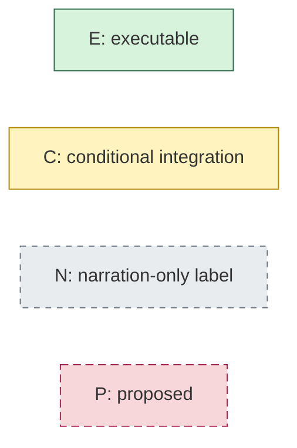
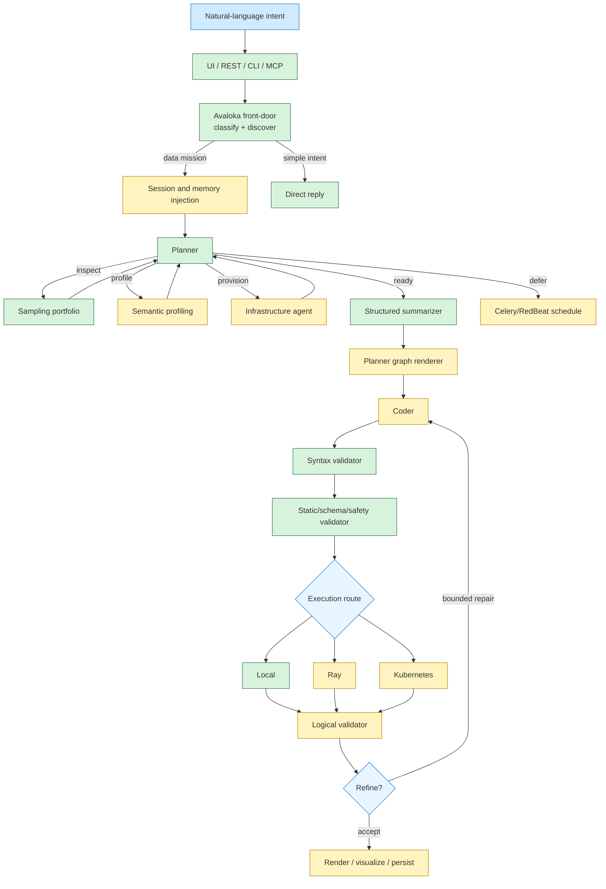
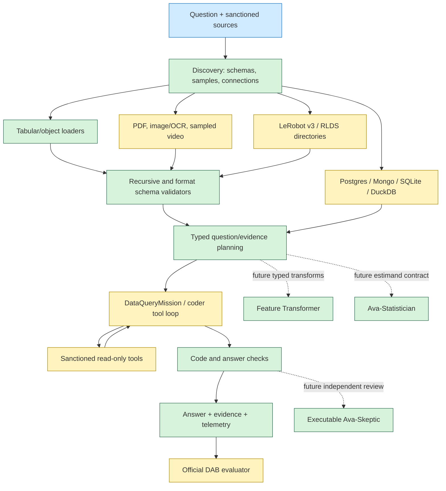
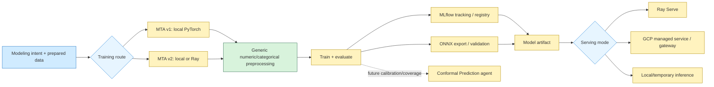
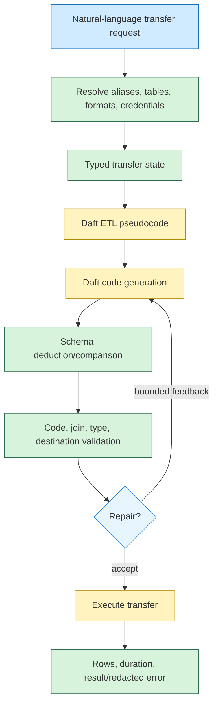
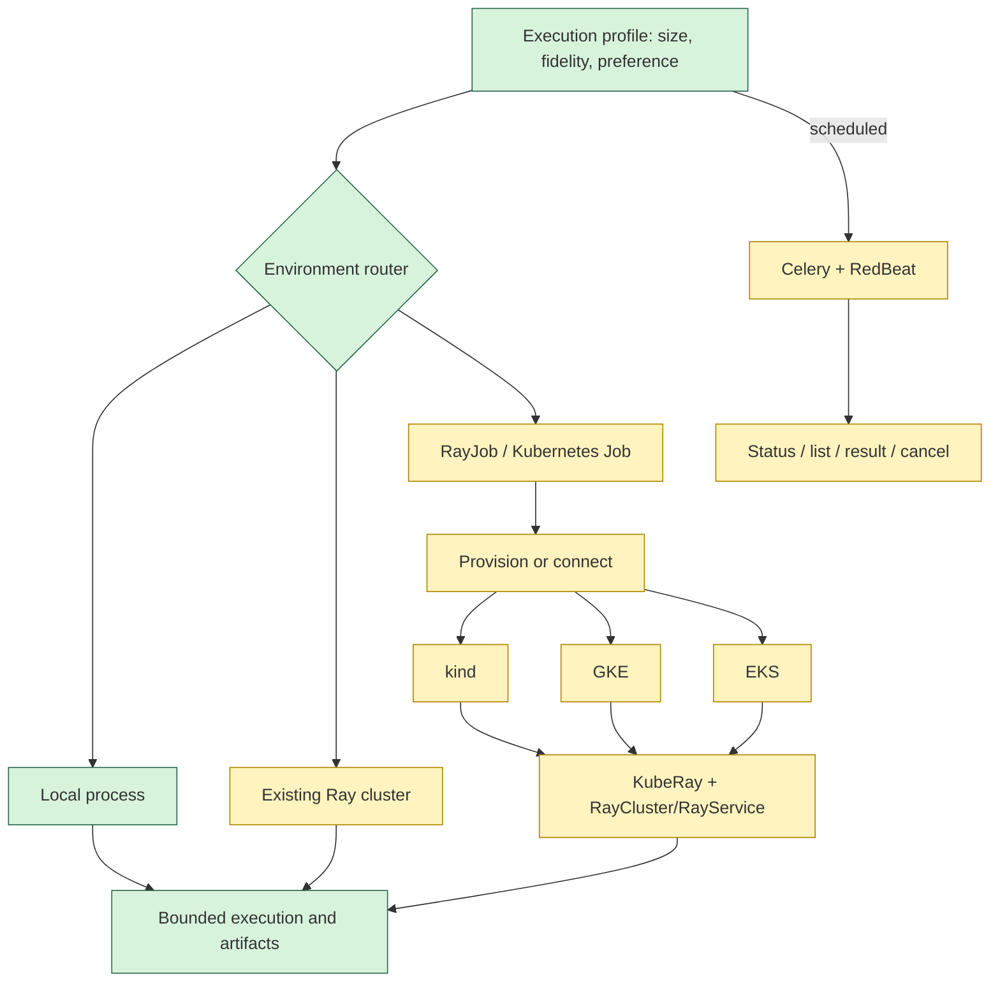
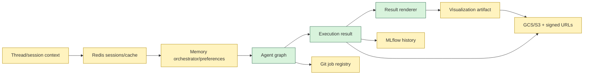

# Avaloka Agent Capability Flow

> **Downloadable source map** | **As of commit:** `5062aacc2866` | **Date:** 2026-08-15
>
> This map distinguishes running code from conditional integrations, swarm narration, and designs.
> A named persona is not assumed to be an executable agent.

## Status legend

| Marker | Status | Meaning |
| --- | --- | --- |
| **E** | Executable | Checked-in behavior is callable or is an active graph node. |
| **C** | Conditional | Code exists but requires optional packages, credentials, services, or infrastructure. |
| **N** | Narration only | A team/swarm label describes work but is not an independent graph node/operator. |
| **P** | Proposed | Design only; it must not be presented or routed as implemented. |

## Capability overview in natural language

Avaloka accepts natural-language intent through REST, the React UI, CLI, or MCP. Its front-door agent
classifies intent, discovers data, restores bounded session context, and either answers directly or
delegates. The planner can sample and profile data, clarify the request, resolve database/cloud
connections, provision infrastructure, schedule work, or freeze the conversation into a contract.

For analysis, the coder emits pseudocode and Python. Syntax, schema-aware static/safety, complex-loader,
and logical checks gate execution; logical rejection can return to the coder. Approved code runs
locally, on Ray, or as a Kubernetes job. Results can be rendered, persisted, and visualized.

Separate paths cover heterogeneous read-only database questions, Daft data transfer, local/distributed
model training, model tracking/export, inference deployment, memory, scheduling, and benchmarks. PDF,
image/OCR, video-frame, LeRobot, and RLDS support is bounded and conditional—not general multimodal
reasoning or robotics training.

The first DAB tranche now includes **Feature Transformer, Statistician, Experimenter, Conformal
Prediction, deterministic Cartographer routing, and an answer Skeptic**. Live schema introspection,
semantic document extraction, and full evidence recomputation remain proposed. Existing helpers
remain useful primitives for those future contracts.

## End-to-end intent and routing

Evidence: [`app/api/workflow.py`](../app/api/workflow.py),
[`app/graph/etl_state.py`](../app/graph/etl_state.py),
[`app/agents/avaloka_agent/agent.py`](../app/agents/avaloka_agent/agent.py),
[`app/agents/planner.py`](../app/agents/planner.py), and
[`app/api/ui_contract.py`](../app/api/ui_contract.py).

## Analytical and data-query mission

Evidence: [`avaloka/io/loader.py`](../avaloka/io/loader.py),
[`avaloka/io/complex.py`](../avaloka/io/complex.py),
[`avaloka/io/schema.py`](../avaloka/io/schema.py),
[`avaloka/data_agent/mission.py`](../avaloka/data_agent/mission.py), and
[`benchmarks/external/dab/README.md`](../benchmarks/external/dab/README.md).

| Complex capability | Status | Boundary |
| --- | --- | --- |
| PDF | C | Embedded text plus bounded OCR fallback; optional PDF/OCR dependencies required. |
| JPEG/PNG | C | Metadata and optional OCR; no general visual question answering. |
| Video | C | Metadata and bounded uniform frames, optionally OCR; no audio/shot/VLM semantics. |
| LeRobot v3 | C | Directory, Parquet, and video-manifest inspection; no policy training. |
| RLDS | C | TFDS directory decoding and episode/step invariants; TensorFlow/TFDS required. |
| Recursive schema | E | Nested, nullable, union, and tensor inference plus drift reporting. |

See [`docs/complex-data-foundation.md`](complex-data-foundation.md).

## Train, register, and inference flow

Evidence: [`app/agents/model_training_agent.py`](../app/agents/model_training_agent.py),
[`app/agents/mta/`](../app/agents/mta/), [`app/agents/mta_v2/`](../app/agents/mta_v2/), and
[`app/serve/inference.py`](../app/serve/inference.py). A serving scaffold is not a live model; check
runtime readiness/model-loaded state.

## Data-transfer flow

Evidence: [`app/agents/data_transfer_agent/data_transfer_agent.py`](../app/agents/data_transfer_agent/data_transfer_agent.py)
and [`app/agents/data_transfer_agent/dta_state.py`](../app/agents/data_transfer_agent/dta_state.py).
Database/object-store connectors and MCP access remain environment-dependent.

## Infrastructure and scheduling flow

Evidence: [`app/execution/router.py`](../app/execution/router.py),
[`app/agents/execution_agent.py`](../app/agents/execution_agent.py),
[`app/infra/`](../app/infra/), and [`app/agents/scheduler.py`](../app/agents/scheduler.py).
These code paths do not imply a healthy cluster, worker, or valid credentials.

## Memory, persistence, and visualization

Evidence: [`app/services/session_service.py`](../app/services/session_service.py),
[`app/services/memory_plane.py`](../app/services/memory_plane.py),
[`app/services/persistence_service.py`](../app/services/persistence_service.py),
[`app/agents/result_renderer.py`](../app/agents/result_renderer.py), and
[`app/agents/visualization_agent.py`](../app/agents/visualization_agent.py).

## Executable agents versus team labels

| Capability | Status | Current truth |
| --- | --- | --- |
| Front-door agent | E | Classifies, discovers, answers directly, or delegates. |
| Planner | E/C | Structured routing and fallbacks; rich reasoning requires an LLM. |
| Sampling / profiling | E/C | Local behavior exists; Daft/Ray and LLM semantics are optional. No confidence-convergence loop. |
| Coder / validator | E/C | Deterministic guards exist; generation and logical review may require an LLM. |
| Execution | E/C | Local is executable; Ray/Kubernetes/SSH/stores depend on environment. |
| Data Transfer Agent | C | Daft generation, validation, execution; needs connectors/runtime. |
| MTA v1/v2 | C | Training components exist; packages, Ray, MLflow, or cloud may be required. |
| Visualization / scheduler / infrastructure | C | Executable integrations with external dependencies. |
| Firefly/swarm roster labels | N or E by module | `avaloka/fireflies/` has callable classes; `app/agents/avaloka_agent/swarm.py` narrates a team plan. A label alone is not a graph node. |
| Feature Transformer | E | Reviewed feature recipes, structured parsing, nested projection, verified joins, and audited transforms. |
| Ava-Statistician | E | Typed deterministic descriptive/inferential operators with diagnostics and reproducibility hashes. |
| Ava-Experimenter | E | Conditional mission specialist with causal refusal, SRM, effect intervals, power, and sample-size primitives. |
| Conformal Prediction | E/C | Split-conformal engines are executable; mission activation requires calibration inputs. |
| Cartographer / executable Skeptic | E | Deterministic source mapping/routing and bounded evidence/output review; live schema introspection remains future work. |

See [`docs/dab-agent-improvement-design.md`](dab-agent-improvement-design.md) for the proposed design.

## Benchmark flow and status
